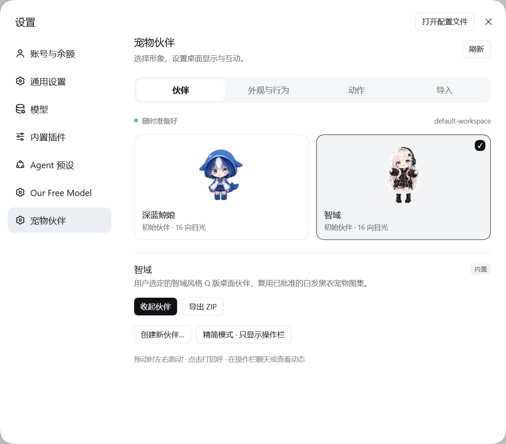

<div align="center">


# dsh-hide-pet

**DeepSeek Harness 的桌面宠物伙伴**

[](https://github.com/HuiHuangDDFS/dsh-hide-pet/tags)
[](https://github.com/HuiHuangDDFS/dsh-hide-pet/releases/latest)
[](LICENSE)
[](https://github.com/HuiHuangDDFS/dsh-hide-pet/actions/workflows/verify.yml)


> 在 Harness 里装上这个插件，让鲸鱼娘和智域走到桌面上，陪你写代码、聊想法，也帮你留意任务进展。
>
> 鼠标靠近，聊天与动态入口轻轻展开；拖动伙伴，面板跟着走。
> 普通消息在后台发送，需要完整上下文时，一键回到 Harness 主会话编辑。

*Animated companions for DeepSeek Harness — chat from your desktop, follow your tasks, and bring your own character.*

[下载最新版](https://github.com/HuiHuangDDFS/dsh-hide-pet/releases/latest) · [功能亮点](#亮点) · [界面预览](#你会看到什么) · [安装](#安装) · [使用说明](#使用说明) · [常见问题](#常见问题)

</div>

---

## 亮点

- **Harness 在后台，伙伴也在桌面上**——Windows 桌面版使用独立透明置顶窗口，主窗口最小化后仍可见；完全退出 Harness 时一起关闭。
- **两个初始伙伴**——内置蓝白鲸鱼主题 Q 版「深蓝鲸娘」和白发黑衣「智域」，在设置中直接切换。
- **会跑、会打招呼，也会看向鼠标**——支持九类动作与十六方向注视；左右拖动时播放对应方向的跑步动画，松开后恢复任务状态。
- **靠近时展开**——鼠标接近伙伴后柔和显示「聊一聊」和「动态」，离开后延迟收起；打开面板时保留操作栏，精简模式始终保留入口。
- **从伙伴旁开始聊天**——选择工作区、新建会话或继续未归档会话，普通消息在后台提交；“在主会话编辑”才唤起 Harness 并聚焦输入栏。Windows 桌面模式支持全局 **Ctrl+Alt+Shift+P**。
- **面板跟着伙伴走**——聊天、动态和完成气泡随伙伴重新定位，靠近屏幕边缘时向内展开；拖动时保留聊天草稿和所选会话。
- **留意多个任务**——显示运行、等待回应、错误及未读完成状态，点击动态打开对应原生会话；确认和审批仍在原生会话中处理。
- **融入 Harness 原生设置**——管理入口就在「设置 → 宠物伙伴」，使用宿主的按钮、开关、输入框与分段控件，支持浅色和深色主题。
- **带上你自己的角色**——兼容 Codex v1/v2 宠物包、PNG/WebP、`pet.json` 与旧版 `avatar.json`；支持 ZIP 导入导出，以及保留宠物 ID 的图集替换。
- **本地管理，配套 skill**——宠物库和偏好保存在本机；提供 `pet_*` 工具、`/pet` 命令和独立 CLI，配套技能可指导创建、校验与导入。

## 你会看到什么

### 桌面上的伙伴

<div align="center">
  
</div>

拖动形象调整位置，点击形象打招呼；鼠标靠近后，底栏出现“聊一聊”和“动态”，再次点击同一入口即可收起。右键可打开伙伴设置、隐藏伙伴或切回应用内显示。上图展示内置形象，入口的最新行为见下方说明。

### Harness 原生设置

桌面版：**左下角「更多」→ 设置 → 宠物伙伴**。Web 版直接进入「设置 → 宠物伙伴」。

<picture>
  <source media="(prefers-color-scheme: dark)" srcset="docs/images/settings-dark.png">
  
</picture>

| 页面 | 可以做什么 |
| --- | --- |
| 伙伴 | 选择形象、显示或收起、导出 ZIP，编辑自定义伙伴信息、替换图集 |
| 外观与行为 | 桌面置顶、大小、精简模式、显示方式、目光跟随、减少动态效果、重置位置 |
| 动作 | 逐项预览九类动作和十六个注视方向 |
| 导入 | 导入宠物 ZIP 或透明 PNG/WebP 动作图，并检查图集结构 |

## 安装

当前版本为 **1.2.5**，适配 DeepSeek Harness **0.2.0-rc.2**。独立桌面置顶功能适用于 **Windows 桌面版**；Web 及其他系统使用应用内伙伴。

### 1. 获取安装包

打开 [最新 Release](https://github.com/HuiHuangDDFS/dsh-hide-pet/releases/latest)，在 **Assets** 下载 [`dsh-hide-pet-1.2.5.tgz`](https://github.com/HuiHuangDDFS/dsh-hide-pet/releases/download/v1.2.5/dsh-hide-pet-1.2.5.tgz)。发布包已包含构建结果，直接安装即可。

也可以从源码构建，需要 **Node.js 22.19+** 和 npm：

```sh
git clone https://github.com/HuiHuangDDFS/dsh-hide-pet.git
cd dsh-hide-pet
npm ci
npm run build
npm pack
```

仓库根目录会生成 `dsh-hide-pet-1.2.5.tgz`。固定版本源码可从 [v1.2.5 标签](https://github.com/HuiHuangDDFS/dsh-hide-pet/tree/v1.2.5) 获取；GitHub 自动生成的 Source code ZIP 仍需构建。

### 2. 安装到 Harness

**桌面版**

在 Harness 的「设置 → 插件管理器」中安装本地 `.tgz`，确认插件已启用，然后重新启动 Harness。

也可使用**桌面安装包自带的 CLI**。先启动过桌面应用以初始化 profile，再完全退出应用；以下为 Windows PowerShell 示例：

```powershell
$harnessDir = Join-Path $env:LOCALAPPDATA 'Programs\DeepSeek Harness'
$petPackage = (Resolve-Path .\dsh-hide-pet-1.2.5.tgz).Path
& "$harnessDir\resources\runtime\cli\bin\dsh.cmd" plugin --profile desktop add $petPackage
```

如果 Harness 安装在其他位置，修改 `$harnessDir`。若使用了自定义 `DSH_HOME`，安装时应与桌面应用保持一致。

**纯 Web profile**

```sh
dsh plugin --profile web add /绝对路径/dsh-hide-pet-1.2.5.tgz
```

将 `web` 替换成实际使用的 profile 名称，安装后重新启动相应的 Harness 服务。升级时按相同步骤安装新版 `.tgz`，已有宠物库和偏好保留。

请安装打包后的 `.tgz`，不要将源码目录作为桌面 profile 的链接依赖，也不要创建 junction。插件通过宿主的 bundle 机制加载，不需要修改 `app.asar` 或覆盖 Harness 安装文件。

### 3. 安装配套 skill（可选）

将仓库中的 [`skills/dsh-hide-pet`](skills/dsh-hide-pet/SKILL.md) 文件夹复制到以下任一位置：

| 范围 | 位置 |
| --- | --- |
| 当前项目 | `<项目目录>/.dsh/skills/dsh-hide-pet` |
| 当前用户 | `~/.dsh/skills/dsh-hide-pet`，自定义数据目录时为 `$DSH_HOME/skills/dsh-hide-pet` |

重新加载技能后，以 Harness 实际发现的技能列表确认。技能用于指导角色创建、图集校验、导入和管理；图像生成仍需要当前环境提供相应能力。显示内置伙伴不需要安装 skill。

## 使用说明

### 选择与调整伙伴

进入「设置 → 宠物伙伴」选择鲸鱼娘或智域。在「外观与行为」中调整大小、目光跟随和减少动态效果；关闭「桌面置顶」即可切回应用内显示。

**精简模式**收起角色形象、保留聊天和动态；**隐藏伙伴**收起整个窗口。可在设置中再次显示，或输入 `/pet show`。

### 聊一聊

点击底栏「聊一聊」，或在 Windows 桌面置顶模式下按 **Ctrl+Alt+Shift+P**。

- 桌面快捷聊天可直接选择工作区及其未归档会话，也可新建会话；默认使用 Harness 当前会话所在工作区。使用前请在 Harness 添加工作区并配置可用模型。
- 应用内聊天栏还可选择工作区或已有会话作为发送目标。
- **发送**：普通文字直接提交到所选会话，Harness 保持后台，不切换主界面的会话。
- **在主会话编辑**：唤起 Harness，打开目标会话并将文字插入原生输入栏，保留已有草稿。需要文件、`@` 上下文、技能或命令时，在这里补充后由你发送。
- **拖动与收起**：桌面面板保持打开并随伙伴移动；再次点击入口、点击关闭按钮或按 Esc 收起，保留尚未发送的文字。

聊天沿用 Harness 的会话与模型配置。伙伴本身不提供模型服务，也不会替你确认审批。

### 查看任务动态

「动态」按需要回应、遇到问题、完成待查看、运行中的顺序展示任务。Windows 桌面栏点击任务打开原生会话；应用内动态栏另提供回复、停止、收起提醒和静音等操作。

查看、收起动态只操作伙伴面板；点击具体任务才唤起对应主会话。聊天与动态从伙伴侧边展开并随其移动。新任务完成后，伙伴朝向屏幕内侧的上角会出现短暂气泡，点击即可查看对应会话；启动时不会重复提醒旧任务。

### 在对话中管理

插件提供 `/pet` 命令：

| 命令 | 作用 |
| --- | --- |
| `/pet show` / `/pet hide` | 显示 / 隐藏伙伴 |
| `/pet mini` | 切换为精简模式 |
| `/pet list` | 列出宠物 |
| `/pet select zhiyu` | 选择智域 |
| `/pet select whale-girl` | 选择深蓝鲸娘 |
| `/pet reset position` | 重置位置 |
| `/pet reset size` | 重置大小 |

也可以让 Harness 执行「列出宠物并选择智域」「把宠物缩小一点」等请求，模型通过插件提供的 `pet_*` 工具操作本地宠物库。

### 导入自己的角色

在设置的「导入」页选择 ZIP、PNG 或 WebP。v2 图集尺寸为 **1536 × 2288**，8 列、11 行，每格 192 × 208，包含九组动作和十六个注视方向。

导入会创建新的宠物 ID；更新已有自定义伙伴时使用「替换图集」，保留原 ID、名称和显示偏好。导出 ZIP 可用于备份和迁移。结构校验通过后，仍需在「动作」页检查画面与播放效果。

完整格式和命令见 [图集说明](skills/dsh-hide-pet/references/atlas.md) 与 [CLI 参考](skills/dsh-hide-pet/references/commands.md)。

## 常见问题

**安装后设置里没有「宠物伙伴」？**

确认安装到了正在使用的 profile，插件已启用，且安装后重启过 Harness。只把 npm 包放入目录，不代表宿主已经激活对应 bundle。具体步骤见 [使用说明](docs/usage.md)。

**命令行提示 `desktop` profile 由 Electron 管理？**

普通 CLI 可能没有桌面 profile 的管理权限。改用应用内插件管理器，或完全退出桌面应用后使用安装包自带的 `resources/runtime/cli/bin/dsh.cmd`。

**最小化后宠物不见了？**

独立置顶窗口仅在 Windows 桌面宿主中启用。确认「外观与行为 → 桌面置顶」和「显示伙伴」均已开启；桌面窗口启动失败时会回到应用内显示。完全退出 Harness 后伙伴关闭是正常行为。

**快捷键没有反应？**

Windows 桌面置顶模式使用固定全局 Ctrl+Alt+Shift+P，其他软件占用该组合时可直接点击底栏。应用内快捷键可在 Harness 快捷键设置中调整，默认按键冲突不会阻止插件启动。

**聊天提示先选择工作区，或发送失败？**

先在 Harness 主窗口选择工作区，并确认所选模型可以正常对话。含 `@`、技能或命令的内容请转入主会话编辑；发送错误会保留在伙伴中供你处理。

**支持 macOS / Linux 的独立桌面宠物吗？**

独立置顶窗口使用 Windows 自带 WPF；其他平台提供应用内显示。实时双向语音、Codex 云端宠物服务、透明像素点击穿透和多显示器吸附尚未实现；多屏混合 DPI 尚未实机验证。

## 数据与隐私

宠物库、选中角色与显示偏好保存在 **`$DSH_HOME/hide-pet`**，默认是 **`~/.dsh/hide-pet`**。ZIP 导出包含角色元数据与图集，可用于本地迁移；本项目不提供云端宠物同步。

Windows 桌面窗口通过私有标准输入输出通道连接插件，不另开网络监听。插件的 HTTP 资源与操作复用 Harness 的连接准入检查。

通过伙伴发送的聊天仍由 Harness 和你选择的模型服务处理，适用该服务的数据规则；本地保存宠物并不改变模型请求的发送方式。

## 开发与验证

在源码目录运行：

```sh
npm ci
npm run check
npm test
npm run build
npm run preview
```

`npm run preview` 启动独立本地预览，适合查看角色和动作；它不等于插件已安装到 Harness。

Windows 上还可运行真实鼠标交互检查：

```sh
npm run test:native
```

该检查会短暂显示测试宠物并移动鼠标，验证跨区点击、按钮文字、聊天输入焦点、动态跳转、左右拖动动画、显示模式切换及进程退出。

当前版本通过 **48 项自动测试**及 Windows 原生编译，并检查桌面聊天、动态与拖动行为。CI 在 Windows/Linux 上执行语法检查、测试、构建和打包验证，结果见页面顶部状态徽章。适配基线、验证边界与更新记录见 [功能对齐说明](docs/feature-parity.md) 和 [CHANGELOG](CHANGELOG.md)。其他 Harness 版本需按实际接口验证。

## 许可证与致谢

代码使用 [MIT](LICENSE) 许可证。角色美术的来源与许可单独记录，见 [资源说明](docs/assets.md)、[鲸娘来源](assets/pets/whale-girl/provenance.md) 和 [智域来源](assets/pets/zhiyu/provenance.md)。

这是独立社区插件，与 DeepSeek、OpenAI 无隶属或背书关系。Codex 宠物行为的参考与实现范围见 [功能调查](docs/codex-pets-audit.md)。

README 的版式与章节组织参考了 [Ebony-Vinyl/dsh-our-free-model](https://github.com/Ebony-Vinyl/dsh-our-free-model)。
